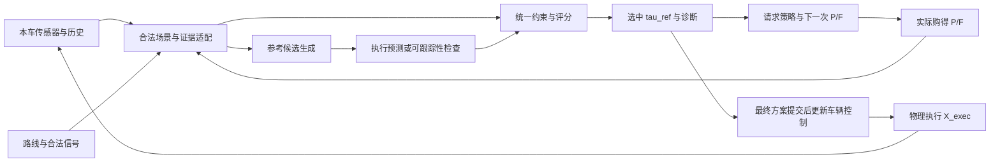

# ToolV2X 研究点一：共同驾驶底座设计评审稿

日期：2026-09-22。状态：**设计建议，待用户审阅；不是已接受的实现设计或可用性结论。**

本轮只阅读文档、实际源码、已有产物和官方资料；未修改实现、安装依赖、运行模型、训练或闭环。已有代码只作为待解释的实现与证据，不作为需求来源。

## 1. 推荐结论

**当前未完成的是共同底座的设计与选型，不能继续按“给 PDM 修几个 bug”推进。** 原 PDM 的参考轨迹、内部预计执行状态、真实控制有不同职责；上一轮把模拟状态直接作为另一个 PID 的参考，没有充分的控制结构依据。两批失败否定的是那套具体适配，不能外推为 PDM 理论上不可用于 CARLA。

建议采用的架构是：**合法对象状态/历史与外部预测 → 成熟的对象级数值规划器 → 明确的带时标参考轨迹 → 独立验收的车辆跟踪器**。预测信息应直接改变时序碰撞约束或候选评价，不依赖重新训练一个驾驶网络才能证明被使用。规划与控制内部参数对所有实验臂冻结；论文创新仍在信息获取与反馈决策。

在本轮核验的候选中，**优先评审 CommonRoad Reactive Planner 核心及其物理控制接口方案；PDM 有限适配作为第二候选**。理由是前者已有显式动态障碍、运动学可行性、带时标状态轨迹接口，更贴合 P/F 可替换输入；这是一项接口适配判断，不是性能排名。其官方 CARLA 包装器默认读取全局 actor、存在 Transform 控制选项，且当前文档面向 CARLA 0.9.15 等较新版本，**不能直接拿来作 ToolV2X**。推荐的是核心规划器加隔离后的合法输入接口，不是照搬其示例。版本、地图、实车参数/跟踪器和失败处理四项未关闭前，不批准迁移。官方来源见第 7 节。

OpenCDA 适合简单规则诊断基线；CoDriving 适合完整学习式外部系统或愿意训练共同驾驶器时的备选；PDM-Lite 原样只适合特权参考。若这些候选均需重写主要规划算法才能满足任务，应明确“尚无低成本可靠底座”，重新评估研究任务与资源安排，而不是维护必须选出一个可用框架的叙事。

## 2. 四类事实必须分开

权威顺序：当前用户指令 > 已确认的研究要求 > 上游明确的接口/算法事实 > 本地实现与 agent 建议。旧文档中的“推荐”“下一步”不自动等于用户批准。

| 类别 | 内容 | 依据与解释 |
|---|---|---|
| 用户已确认 | 只推进研究点一；有限预算获取邻车私有 P/F；真实返回后由同一 PLAN 修订，并影响下一请求/STOP | [9-19.md](9-19.md)；[user_requirements.md](user_requirements.md) 09-19 条目；本轮用户指令 |
| 用户已确认 | LLM 决定调用而非低层数值轨迹；初始 PLAN 和返回后的 PLAN 强制执行；首版最多两次远端调用 | 同上；每个信息获取 episode 最多三次 PLAN，不等于整段驾驶只能规划三次 |
| 用户已确认 | 时间 t 因果信息、未购买的 peer 上下文不可见、各策略使用相同底座与公平成本；GoT/PDM 不必保留 | [AGENTS.md](../AGENTS.md)；9-19 与当前指令 |
| 用户已确认 | 当前仅阅读、分析、设计；先交具体方案供审阅 | 当前指令，优先于旧实施授权 |
| 上游原始事实 | PDM 生成参考候选，用内部 LQR/自行车模型预测执行，再评分；通常返回所选 generator 参考 | 原始 `abstract_pdm_closed_planner.py` 136–189 行。两种轨迹不同本身不是 bug |
| 上游原始事实 | PDM 原配置 proposal 4 s、输出 8 s；本车动力学、地图、对象状态及时间索引有具体假设 | 原配置与 generator/simulator/scorer；不是 ToolV2X 已确认时域 |
| 上游原始事实 | CARLA VehiclePIDController 接收目标速度和位置，产生油门/刹车/归一化转向；其状态和车辆物理响应不同于 PDM 内部 LQR | 本地 CARLA 0.9.10.1 `agents/navigation/controller.py` |
| 本地实现选择 | V2Xverse 检测、AB3DMOT、PDM core、CARLA 0.9.10.1/Town03、固定路线、4 m/s 上限 | 已运行工程配置，可重新选择；安装成功不是主实验选型已通过 |
| 本地实现选择 | 2/3 s 时域、0.1 s PDM dt、0.2 s occupancy、±1 m 偏移、top-1 F、远端优先、yaw-rate/speed 转角近似 | [pdm_core.py](../src/planning/pdm_core.py)、两个 probe 与 [9-22.md](9-22.md)；均非用户不可变要求 |
| 本地实现选择 | 两点路径差分速度、Kp 0.2、0.5 s 预览、停车滞回、0.25 低速油门上限、全零候选制动 | [pdm_control.py](../src/planning/pdm_control.py)、[候选 probe](../scripts/probe_pdm_project_adapter.py)；未因代码存在或单元测试通过而获设计认可 |
| 尚未解决 | 正式任务域、预测覆盖时域、车辆状态可观测性、控制器适用域、地图/信号契约、P/F 的真实价值、独立测试划分 | 见第 9 节。不得把未知填成默认成立 |

`9-22.md` 自称“工程建议”，其中 PDM 薄适配、top-1 F 等是建议；此前用户允许接入/诊断，也不能解释成接受这些选择作为最终论文设计。`9-19.md` 的“STOP 或条件”字面规则与首步 teacher 是否考虑第二步仍需澄清：本设计建议 STOP 与所有合法动作的净价值比较，且将事后 oracle 与受限信息 teacher 分开，不自动沿用未讨论的公式。

### 已有失败能支持到哪里

| 产物 | 已核实事实 | 不能推出 |
|---|---|---|
| `pdm_closedloop_2026_09_22_v3/v4` | v4 原门槛 PASS；运行前另写入的附加持续低速/加速度诊断 FAIL，约 9.27 m/s² 起步纵向峰值仍在。两套判据分别保留，不追溯改写原 PASS | PID 调参已经建立可靠底座；PDM 的控制适配完成 |
| `pdm_project_adapter_2026_09_22_v1` | 空路/前车/前车驶离全部 FAIL；不可行制动分别 6/86/29 帧 | 新输出契约的测试 PASS 等于车辆能执行；前车停住等于正常规划停车 |
| 同名 `v2` | 移除横向偏移后仍三臂 FAIL；不可行制动 8/18/20 帧 | ±1 m 偏移是全部失败的唯一根因；取消换道就完成适配 |
| 两批原始 `frames.jsonl` 与源码 | 参考消费方式、控制增益、停车规则、状态估计等曾同时变化 | 可以从批间结果精确辨识单一控制机制，或证明某个框架必然不可适配 |

固定 ±1 m 偏移与当前 3.50 m 车道/2.128 m 车宽确有几何冲突：稳态允许中心偏移约 0.686 m。该事实支持“候选必须符合任务几何”，不支持把论文永久缩成中心线跟车。新方案的失配可能涉及双层跟踪、低速转角估计、挡位/执行延迟等；**唯一根因尚未辨识，本设计不任选一个当事实。**

本轮重新读取了上述 summary、源码与指定文档；对已有数据的独立复核见各证据目录。没有重跑 planner 或 simulator。

## 3. 从研究问题推导最低能力

共同底座首先要支持有意义的决策差异，而不只是“能停车”或“能接受 P/F 字段”。建议以以下任务族定义初版研究域，作为本稿提案而非已批准场景：

| 任务族 | 信息缺口 | 共同底座必须能表达的行为 | 不预设的结论 |
|---|---|---|---|
| P 价值：遮挡/观测缺失 | 邻车看到本车未见或历史不完整的交通参与者 | 新目标进入同一场景；改变可行速度、等待/通过时机或路径选择 | P 一定更准确、每帧都改善 |
| F 价值：同一当前状态，不同未来占用 | 当前位置相似，但过去运动/更完整上下文支持不同未来 | 同一参考候选在不同时间与对象发生冲突；预测改变候选可行性、代价或选择 | F 优于 CV；远端模型有额外神秘信息 |
| 反馈价值：第一次返回改变关注区域/时间 | 第一轮修订改变第二次获取哪一类/哪一目标证据的价值 | 可复算的时空方案变化，能改变后续 provider 排序与策略动作 | 两次调用必胜一轮；轨迹不同即驾驶更好 |
| 跨前三类任务的 STOP/无增益负对照 | 远端重复、无关或本车已充分观测 | 在同一效用和预算下允许不通信，维持可用驾驶 | 空返回意味着未知区域安全 |

STOP、重复和无关证据应在上述任务族、路线难度与本地可观测复杂度内分层配对，不能主要拿独立简单空路充数。若本地可见状态完全相同而私有信息价值不同，应承认在线不可辨识、按期望价值决策，不能要求策略复现逐样本知情 oracle。

这些任务至少需要路线跟随、受控减速/停车/恢复、对动态冲突的等待与通过；是否包含自主换道、强互动并道、复杂信号路口须另行确认。**不把交互博弈作为当前 F 的隐含能力**：现有 F 是完整合法上下文上的非 ego-plan-conditioned 预测；current/change 主要改变请求排序，不使预测器预测对本车新方案的反应。

共享底座还必须能提供：有效的时间参数化方案；约束失败原因；对控制模型误差的说明；同证据确定性；按 source/field 追踪信息消费；独立于内部相对分数的驾驶评价；在留出任务变体上保持基本能力。Planner 可以随证据改变候选，但算法、采样规则、参数、计算额度和物理状态快照必须对各臂相同，不能给某个臂更多候选或更强保护。

## 4. P 与 F 如何实际影响同一个规划器

记 `S_t^k = Assemble(local_t, acquired_E_0:k, route_t)`，同一个规划器运行：

`PLAN(S_t^k, frozen_physical_memory_t) -> reference_tau_k, evaluation_trace_k, status_k`。

这里的统一场景只表达目标状态及预测，不是新增一个需要训练的世界模型。新后端若返回不同采样数或时域，必须先设计到既有六点请求轨迹的版本化投影与有效覆盖；不能把2秒四点当作旧3秒六点，也不能为补足格式拼接未定义的尾段。

### 4.1 P：改变“已知有什么及它怎样运动”

P 返回目标当前锚点、尺寸、朝向及带有效位的过去状态。接收端变换到共同坐标后做实体关联，保留远端独有目标；只有因果历史可以参与速度/运动状态估计。只有在明确允许 `P-local-prediction` 时，接收端才用已购 P 运行相同预测器，并单独计费。

默认 P-state 路径的因果链应是：

`P 新状态/历史 -> 同一实体场景变化 -> CV/指定本地预测变化 -> 目标时序几何或前车间距变化 -> 候选约束/评价或生成变化 -> 选中参考变化`。

在 CommonRoad 类方案中，P 新增或更新动态障碍的当前状态和共同基准预测，改变同一批轨迹的动态碰撞检查。在 PDM 方案中，P 还可改变 leading-agent/gap，从而改变 IDM 纵向候选。两者都不能只以“输入里出现 P”证明有效使用。

### 4.2 F：改变“未来何时占用哪里”

F 返回当前锚点及未来轨迹/模式。对已有或新引入实体，接收端将合法 F 转成同一坐标、同一绝对时标下的未来几何；未来位置、朝向和速度必须一致，不能只替换 polygon 而让 TTC/停止判定读另一套速度。未取得 F 的实体继续使用所有臂共用的基准预测规则，不免费调用 peer 模型。

作用链是：

`F 时间序列 -> 目标未来位置/朝向/速度 -> 同一参考在各时刻的冲突/余量变化 -> 同一评价/约束 -> 候选选择或参考速度变化`。

例如：两条本车参考分别在 2 s 与 4 s 到达冲突区域；P-state 的 CV 与 F 给出的占用时间不同，可以改变等待/通过选择。这个例子说明结构上的作用途径，**不是现有 MTR 已能预测这种情形的证据**。

首版建议保留全部 F 模式和分数供审计，规划消费可先采用明确的 top-1 规则，以免把多模态风险融合变成第二个研究课题；这是待批准的工程选项，不是完整不确定性利用。若 top-1 系统性漏掉目标任务的重要分支，应暂停该方案，重新设计消费策略，不能事后挑选有利 mode。

### 4.3 必要归因与实体规则

- **F 自带锚点**，可能新增本车未见目标。完整 F 对 Ego 的差异是整包能力收益，不可全部归为预测价值。对同一个已返回目标集合及相同锚点，对比 `F-future` 与 `F-anchor + 同一CV`，只能识别“固定已选集合后的预测消费增量”；若选择集合本身用了 forecast，它不是完整 F 服务的纯预测归因。
- 完整 P 上下文、相同时间窗/模型/预处理下的本地重算，才是 remote F 的同信息对照。ROI/容量截断后的 P 是子集对照。成本必须保留全量 P 的字节和本地计算。同信息控制按各自实际成本报告，不同时宣称资源等价；等预算控制统一资源上限和计费规则，不保证取得同一信息或实际消耗逐项相等。RPC 轮数与墙钟延迟差异要单列，不以“公平”名义抹去。F-anchor stripping 是保留原返回和费用的接收端消费消融，不能包装成一个更便宜的真实服务。
- 本车与 peer track ID 不可当全球真值 ID。先以时空几何、尺寸及历史作关联；确定匹配的实体不得重复计为两辆车，歧义保留为来源假设。首版建议采用已有确定性关联框架，不新造学习式融合模块；跨 CARLA 的阈值和误差适用性尚未验证。
- 当前状态来源选择与 forecast 来源选择分别记录。不能默认“remote 永远更准”，也不能未经说明把远端预测起点平移到本地框上。首版来源选择/冲突公差须在对照前冻结；其改变属于共用适配而非策略优势。
- 记录五层证据：实际买到什么 → 哪些字段进入场景 → 哪些候选/约束发生变化 → 选中方案变化 → 独立驾驶结果是否改善。每层均可能不通过，不能用前层替代后层。

当前实现的依据和边界：`vehicle.py` 的 `query_task/_execute_task` 在完整上下文预测后按请求排序；`pdm_core.py:scene_from_ledger` 存在单模态选择与来源优先规则；这些是可审计的现状，不自动成为最终语义。

## 5. 模块职责和不可混用的接口

以下是**提议的逻辑接口**，尚未新增任何类或代码。数据结构可复用现有 ledger，不要求再建一套框架。

| 模块 | 合法输入 → 输出 | 职责和禁止事项 | 已成立 / 待验证 |
|---|---|---|---|
| 感知/跟踪 | 本车当前/过去传感器、本车标定/运动 → `LocalTracks_t` | 时间戳、框、速度/历史、有效位、source；不能从 simulator 补对方真值速度/ID | 独立检测链已运行；召回、关联、运动精度和目标任务质量待验证 |
| 证据适配 | LocalTracks、实际 receipts/P/F、静态路线/合法信号 → `SceneSnapshot_t^k` | 坐标/时间对齐、关联、来源及完整上下文边界；对象数据不含 World/Actor 句柄 | 现有 ledger 可复用；新环境数值契约与模式/时域处理待验证 |
| 候选生成 | 同一自车状态、路线、约束、合法 Scene → `ReferenceSet` | 路径及速度时间律、机动域、完整车身几何和可执行性；不是 LLM 输出任意 waypoint | 上游有实现；是否覆盖研究任务未知，不能永久只用短直路证明 |
| 执行预测/可跟踪性 | 参考、物理时刻冻结的自车/控制状态、固定车辆/跟踪模型 → `ExpectedEgoMotion` 或误差界 | 解释参考在指定执行器下怎样实现。PDM 有显式模拟；其他规划器可用运动学轨迹加经验证的跟踪误差界，但必须披露近似 | 当前 PDM 模型与 CARLA PID 一致性未建立；不能把模拟状态再喂第二个 PID 视为自然修复 |
| 评分/约束 | 参考/预计执行状态、目标时序几何、路线/规则 → 可行性、分项代价、选择 | 碰撞、路界、动力学、进展/舒适等在同一尺度定义；无可行要有原因，不能静默 index 0；也不沿用未经讨论的“全部硬项=1”阈值 | 原指标含义可查；阈值、预测误差及模型误差容忍尚须设计 |
| 车辆控制 | 最终选中**参考**、当前本车测量、自身控制记忆 → throttle/brake/steer 或支持的物理控制接口 | 单位、参考点、预览、挡位、执行延迟、限幅、停车保持/释放；只在物理 tick 更新 | 当前两个 PID/模型并不一致；原参数和上一轮滞回均不是已接受规格 |
| 独立评价 | 执行记录、评价专用真值 → 驾驶指标/离线效用 | 不把 future GT、全局 actor 或候选未来收益回送在线输入 | 历史分离机制可借鉴；新闭环任务与分组评价待定义 |

必须区分三个量：

- `tau_ref`：规划器希望执行的路径/速度参考；它可以具有可控的初始跟踪误差，不能仅因参考首点不同于真实位置就一律认定错误。
- `X_hat_exec`：在指定模型与跟踪器下预测的自车实际状态；其初态必须对应当前实测/合法估计，来源和模型明确。
- `X_exec`：CARLA 后续真实执行的状态，只有执行以后才可用于评价和下一个物理时刻。

Agent 的 current/change 以 `tau_ref` 为稳定请求语义；必要时将 `X_hat_exec` 的评价摘要单列。控制器消费该参考及明确速度语义，不能把后验 `X_exec` 或另一控制器的输出状态序列混为参考。

### 时间、状态与预测覆盖

建议内部使用世界右手系米/秒、绝对采样时刻，明确后轴/车身中心/传感器参考点。是否在模型内部转为 ego-local/Frenet 由适配层承担；同一信息 epoch 的投影原点不能随返回改变。至少分别记录 measurement time、provider prediction origin、receive time、decision time 和 valid-until。

规划时域不能由旧 JSON 的六个点倒推。设评分时域为 `H_score`、后端额外 TTC 访问为 `H_extra`、证据龄期为 `age`，若候选生成/参考延展也读取目标未来、其最远访问为 `H_generation`，则使用的预测必须覆盖 `age + max(H_generation, H_score + H_extra)`；本车输出参考也须覆盖控制提交周期和合法停车需要。PDM 具体版本有额外约 1 s TTC 访问，且其8 s参考延展仍调用leading-agent更新；因此原4 s评分至少访问5 s预测，而声称8 s参考全程按F生成还要求8 s覆盖或明确尾段策略。其他后端按实际访问确定。`age` 是预测起点到最终 PLAN/控制提交的**物理时间差**，各 H 均从该规划物理时刻起算。同步暂停期间墙钟等待不增加物理 age；异步模式必须计入队列、推理与提交期间经过的物理时间。超出 F 支持范围只能采用事前声明、所有臂相同的后续预测规则并标记来源，或判该 F 不适用；不能静默截断、外推或继承原长时域分数。

**本稿不把当前 2/3 s 或原版 4/8 s 定为最终值。** 最终时域要由速度域、停车/避让任务、原生 F 支持及评价时间窗共同确定，这是待审阅决策。

同 t 的 k=0/1/2 PLAN 共享实车状态、上一物理时刻的控制记忆、路线进度和随机状态；不能对实车施加中间控制。上一信息阶段的 tau 可用于请求和数值 warm-start，但不会推进 PID 积分、仿真 iteration 或车辆挡位。相同证据重跑只检验确定性和费用，不冒充反馈收益。

### 控制与无可行状态的设计原则

控制器必须先独立跟踪预先给定、动态可行的参考族；验收参考点、速度定义、方向/单位、挡位初始化、命令生效延迟、饱和与低速状态可观测性。低速 yaw-rate/speed 比值不能直接当可靠轮角；若仿真版本可读本车物理轮角，应先校准符号/单位/等效轴角，否则须验证估计器或选择不依赖该量的已知控制接口。CARLA 0.9.15 文档提供本车 `get_wheel_steer_angle`，这证明接口存在，不证明升级后闭环自然可靠。[CARLA API](https://carla.readthedocs.io/en/0.9.15/python_api/)

`STOP` 是停止获取远端信息；`NO_FEASIBLE_PLAN` 是规划失败；`BRAKE/HOLD` 是物理动作，三者不能合并。共同应急策略应作为执行基础单列来源与次数。若保护制动经常替代规划，底座不得通过；无碰撞但长期不动同样失败。何种正常停车条件、失败制动减速度、何时恢复，由完整参考语义和独立控制设计确定，不复用上一轮临时数值当既定答案。

## 6. 保留 PDM 的有限适配方案及退出边界

若选择 PDM，应从原始职责重新构建设计，而不是接着失败 v2 加补丁：

1. 保留参考候选 → 内部预计执行 → 原分项评分 → 所选参考的语义。明确 `tau_ref/X_hat_exec`；导出速度须来自一致的参考时间律或原 IDM 状态，不从未填充的速度槽读零，也不任意用远期两点差分代表当前控制目标。
2. 地图适配负责同版本路线、车道/路界、路口与合法信号。机动候选应符合完整路线任务与车身几何；横向偏移不是固定 ±1 m，也不默认一律取消。若保持某种纯纵向任务，必须作为论文任务域明确批准。
3. P/F 通过唯一时间索引对象接口影响未来位置、朝向、速度、尺寸和碰撞类别判定；扩展点限定在 observation/leading-agent/评分对象查询处。单模态或多模态消费策略事前冻结。
4. 为内部 ego 预测与实际执行器选一种有依据的关系：相同的可复用跟踪器加已验证车辆模型，或保留近似 LQR 并证明其误差不会破坏目标域内的候选评价。不能只修轴距就宣布整个模型一致；不能用样例车辆几何、当前 yaw-rate 近似和另一套 PID 参数拼成事实模型。
5. 明确同 t 重入、候选代价含义、失效/保护输出及审计。内部 progress 归一化分数不跨 stage 比大小，更不是离线 teacher 的效用。

允许的有限改动：输入白名单/坐标/地图/时标；对象预测查询；参考状态导出；原 path×IDM 候选族内按车道净宽/车身和采样范围配置合法候选；一个只消费所选 `tau_ref` 的车辆执行适配。新增机动拓扑、优化目标或候选生成机制计入算法重写，不借“参数化”越过边界；不得将 `X_hat_exec` 再包装成外部控制参考。需要先形成这些修改的完整接口说明与可证伪假设。

出现任一条件就退出“PDM 有限适配”路线：

- 必须同时重写候选生成机制、内部跟踪模型和评分目标，才能覆盖已批准任务；这已经是新的规划器项目。
- 无法建立合法可观测的自车状态或可接受的预测—实际跟踪误差；依赖持续场景专用规则才能运行。
- F 只有替换大量内部逻辑才能产生正确时间语义，或不得不长期把任务/预测时域缩到无法检验研究机制。
- 正常行驶主要靠保护规则接管；只有删除有研究价值的场景才能“通过”。

已有失败尚不足以证明上述所有退出条件都成立，但足以撤销“PDM 已接通所以只需少量调参”的假设。

## 7. 备选比较与推荐的具体改动范围

比较的是对本研究任务的适配代价和可解释性，不把不同论文公布分数直接排名。

| 路线 | 原生 P/F 适配性 | 需要的新工作 | 推荐角色 / 退出条件 |
|---|---|---|---|
| PDM 核心有限适配 | 对象状态原生；外部 F 要统一未来状态查询；有候选、内部模拟与评分 | 第 6 节五项；ego 内部模型与实际控制需建立关系 | 第二候选；超过有限边界则停止迁移 |
| CommonRoad Reactive Planner 核心 + 隔离后的 CARLA 执行接口 | 场景动态障碍与带时标预测进入碰撞检查；输出时间参数化状态轨迹，无需先训练 planner 才接 F | 合法 Scene→Scenario/CollisionChecker；静态地图/路线；冻结时刻重入；实际车辆参数与物理跟踪；清除官方 wrapper 的 world 输入/隐式状态 | **优先设计候选**；前提是版本、合法输入、控制及机动域闸门通过。需要新写主要采样/优化算法或回退到特权/瞬移控制则退出 |
| OpenCDA 行为/局部规划核心 | P 当前对象易接；原生无 F 时序预测接口；对外主要是速度和目标位置 | 合法对象/信号快照；F-aware 时序碰撞；完整 tau 导出；同 t 状态隔离 | 简单规则诊断对照。若为 F 和时间轨迹需要重写 local planner，则不作主底座 |
| CoDriving/V2Xverse 学习式规划 | 有传感器到 waypoint/控制链；P 改 occupancy/特征输入，F 不是现成通道 | 重新设计 F 编码、同臂证据注入、监督和共同训练；验证原特征通信不绕过预算 | 外部完整系统或训练型备选；不能把新输入当原 checkpoint 已会使用 |
| PDM-Lite | CARLA 控制闭合，内部有未来 OBB；默认是特权 expert | 切断全局 actors/control/scenario，重建合法感知/信号、P/F 与状态接口 | 原样仅特权参考；不能通过仅替换预测函数获得输入合法性 |

### 7.1 为什么优先做 CommonRoad 核心的 G0 接口评审

作者工具页说明其使用 Frenet 多项式采样，检查运动学可行性和静/动态碰撞；这与“同一候选规划器消费不同合法 P/F 时序对象”有直接接口对应。接口文档公开 `set_collision_checker/reset`，可从调用者提供的场景/检查器重建每次规划，不必把 simulator world 交给规划核心。[作者工具页](https://commonroad.in.tum.de/tools/commonroad-reactive-planner)、[核心接口](https://cps.pages.gitlab.lrz.de/reactive-planner/reactive_planner/)

其 CARLA 项目提供 PID 与外部 predictor 示例，说明规划和控制的接入路径存在；不是本项目已复现的证据。[PID 示例](https://github.com/CommonRoad/commonroad-carla-interface/blob/develop/tutorials/motion_planning_pid.py)、[预测示例](https://github.com/CommonRoad/commonroad-carla-interface/blob/develop/tutorials/motion_planning_with_cr_prediction.py)

建议的修改边界为四块，均是接口工作：

- **合法场景转换**：只以本车观测与已购证据建立动态障碍；初始 scenario/cache 仅保留合法静态地图。P/CV 与 F 使用相同 DynamicObstacle 时序几何入口。
- **规划调用包装**：从当前自车状态和冻结物理记忆调用核心；设合法路线、限速和相同采样预算；以显式 status 返回 None/无解，不默用旧方案或默认速度。
- **物理执行适配**：使用明确的物理控制模式与实际车辆参数；先验收参考→控制。不得用 TransformControl 移动车辆冒充物理闭环。
- **现有 ToolV2X 内环绑定**：将完成的参考和分项诊断送回既有执行器/请求策略；控制器只提交最终参考一次。

这仍有必须关闭的风险：官方 CARLA controller 在 `create_scenario_from_world` 遍历 actors；内层会推进自身时间，不能直接用作同 t 三次 PLAN；且支持 TransformControl。必须替换该在线组装路径，而不是将其跑通称“合法感知闭环”。[官方控制包装源码](https://github.com/CommonRoad/commonroad-carla-interface/blob/develop/crcarla/controller/commonroad_planner.py)

另一个源码风险是 ReactivePlannerInterface 将 `_reference_velocity` 设为示例常数，并缓存初始化 collision checker；构造临时去障碍副本后实际传入的仍是原场景。这里推断**可能遗留初始动态对象**，不能把这一推断直接当已运行缺陷。设计上应使用 map-only base，并由合法 snapshot 每次重建动态部分；限速来自任务/地图，不继承示例常数。[规划包装源码](https://github.com/CommonRoad/commonroad-carla-interface/blob/develop/crcarla/controller/reactive_planner.py)

官方当前 README 使用 CARLA 0.9.15 并说明更高版本选项；与现有 0.9.10.1 不同。本稿**未批准升级、未验证向后兼容、未确认地图转换和原检测权重在新仿真版本上的质量**。若必须严格保留 0.9.10.1，则官方 bridge 不能被当作现成可用件，应重新比较所需执行适配，不能只为采用 CommonRoad 强行迁移。[官方 README](https://github.com/CommonRoad/commonroad-carla-interface)

尚未关闭的另一项接口假设是：能否只增加有限日志导出，就取得确定性候选、拒绝原因、分项代价和选择依据。公开接口显示部分轨迹/失败统计，但本轮未完成所有内部 trace 的覆盖核验。若必须改写主要采样/优化逻辑才能完成第4节的作用审计，也触发该候选退出。

因此推荐强度是“接口匹配优先、需通过设计和验收的候选”，不是“更换框架即解决”。

### 7.2 为什么其他路线没有直接取代它

OpenCDA 的行为规划与控制链可复用，但官方 perception 即使开启检测仍存在从服务器补目标状态的路径；必须绕开这些动态真值访问。外部 F 与带时标完整 tau 都需要新增接口，因此不能仅凭 CARLA 原生就视为低风险主底座。[行为规划](https://github.com/ucla-mobility/OpenCDA/blob/main/opencda/core/plan/behavior_agent.py)、[感知实现](https://github.com/ucla-mobility/OpenCDA/blob/main/opencda/core/sensing/perception/perception_manager.py)

CoDriving 的本地源码表明规划器输入为历史 occupancy、warped BEV 特征及导航目标，输出 waypoint；检测推理会替换动态 occupancy，所以不能笼统称在线主链直接使用全部 GT。但外部 F 不在现成输入契约内，新加通道/编码后需要共同训练与质量验证，原权重的收益不能继承。训练使用未来自车监督本身也不等于在线泄漏。来源：[planning_end2end.py](/root/autodl-tmp/toolv2x_backbone_research_2026_09_19/CoDriving/codriving/models/planning_end2end.py:49)、[在线/离线推理入口](https://github.com/CollaborativePerception/V2Xverse/blob/main/codriving/tools/inference_e2e.py)。本轮禁止训练只限定本轮工作，不等于永久禁止未来训练；只是这条路线的项目投入更大。

PDM-Lite 明示为 privileged expert；需要切断全局车辆、控制量和场景特定分支才能满足研究契约，不是单个 adapter 可以担保。CoLMDriver 是重要近邻与外部比较，但未核实到可直接复用的独立 P-state/F-trajectory 接口。[PDM-Lite](https://github.com/OpenDriveLab/DriveLM/tree/DriveLM-CARLA/pdm_lite)、[CoLMDriver](https://github.com/cxliu0314/CoLMDriver)

可复用性还包含论文代码发布条件。OpenCDA 的 academic license、CommonRoad bridge 的 GPL 声明、CoDriving 各子模块的授权需逐项确认后再决定分发方式；本稿不作完整许可证法律判断，也不把“可查看源码”当“可任意再发布”。[OpenCDA LICENSE](https://github.com/ucla-mobility/OpenCDA/blob/main/LICENSE)、[CommonRoad README](https://github.com/CommonRoad/commonroad-carla-interface)

## 8. 设计先于试验的最小验证顺序

以下均是**审阅通过后的提议，不是本轮授权运行清单**。每步先冻结输入契约、判据、可修改范围和终止条件；失败先判断假设/模块是否适合，不自动追加试验或以改小任务维持选型。

| 顺序 | 验证什么与输入 | 通过应当证明什么 | 失败意味着什么 / 下一处理 |
|---|---|---|---|
| G0 纸面/源码设计闭合 | 明确任务族、场景权限、实际状态可观测性、时域、候选/控制关系和版本；静态追踪所有上游读取 | 每个必要量有合法来源，P/F有实质消费路径，控制参考含义完整，没有不可执行的隐含转换 | 不具备实施条件；补设计或淘汰候选，不能先启动CARLA找答案 |
| G1 纯数据与重入契约 | 人工可核对的坐标/时标/实体/预测；固定同t重复与兄弟分支 | 无未来/未购信息；姿态和时间一致；没有推进控制历史或污染分支；无效输入显式失败 | adapter/时序契约不成立；这是实现缺陷，允许针对性修正但不推论方法失败 |
| G2 独立执行器 | 与P/F、检测、候选选择无关的预先给定可执行参考族：静止启动、恒速、曲线、减速到停、保持、恢复、参考切换 | 同一控制器在批准速度/曲率域内可靠跟踪，物理响应/延迟/饱和可解释；没有瞬移或场景专用代偿 | 控制接口/车辆状态/模型不适合；不能归咎感知或继续训练Agent。先作一次有依据的重新设计，仍需另换执行器则重审工作量 |
| G3 规划—执行一致性 | 固定当前理想对象状态及预声明CV/预测，单独标记诊断；不让未来GT进入在线 | 合法参考、可行性与实际执行一致到预定误差范围；动态冲突、停车/恢复和无解行为均符合设计 | 候选/时域/评分/模型假设不适合；若需改主要算法则触发后端退出，不用保护刹车制造成功 |
| G4 真实本车链 | 完整同版本传感器、跟踪、自车/路线，跨预先分组的任务变体；无远端输入 | 本车基本驾驶可用；感知噪声/漏检的影响可识别，不能长期由保护接管 | 可定位到真实输入质量或其契约；仅在证据支持时更换/适配感知预测，不能泛化责怪planner |
| G5 固定P/F配对作用 | 同一时刻固定Ego/P/F/PF，含F-anchor/CV及完整P本地重算，冻结planner/controller | 分清取得→使用→修订→获益/损害；P/F在目标任务分布有可复现增量，且成本和信息匹配 | 若有字段无作用是消费设计失败；若真实F常错是能力/域迁移问题；理想证据也无作用则是任务/候选表达不足，不训练LLM掩盖 |
| G6 反馈与论文研究门 | 共享真实首前缀的第二步分支；无增益/STOP、frozen、same-evidence、等预算one-shot | 不只是轨迹变化，而是可部署信息下的第二次获取有价值；在独立任务组上有质量—成本空间 | 若只有事后oracle可利用或one-shot已覆盖收益，应收缩/修改研究主张，而不是继续改底座制造优势 |

G2、G3 的输入域、数值阈值和退出条件须在首次 G2 校准前联合冻结。G2 通过后，controller 参数在 G3 锁定；若用 G3 结果修改 controller，原 G2/G3 验收不再支持新版本，须回到独立校准集并使用未查看的验收组重新开始。

为避免无限验收，G0 同时冻结每个模块的工作包与退出条件；G2/G3/G4 各自使用独立校准与验收场景组。允许校准执行器参数，但校准族、优化目标和次数上限必须在看验收结果之前固定；失败的验收记录不能变成新调参集后仍称独立通过。

判据不能继承旧 probe 的“160步、末速<0.5”作为论文需求。建议至少包含：每段跟踪误差、稳态速度误差、纵横向加速度/jerk、连续停车窗口、恢复条件、碰撞/越界、目标进展、保护与无解占比。具体数值由批准任务域和误差余量推导，例如：

`可用横向余量 > 车身包络余量 + 地图/定位误差 + 允许跟踪误差`。

每个阈值在实跑前落实为数值；**当前这些值尚未确定，所以本稿不是可直接开跑的实验配置。** 不能通过验收后补写阈值。传感器/轨迹错误也不能仅凭均值被掩盖。

G6 的在线 policy 和受限信息 teacher 只能读取同一合法前缀；future GT 仅在分支完成后由独立 outcome 评价器读取。看完所有未来再逐样本挑最好分支仅记为 hindsight-oracle 上界，不称可部署 teacher。第二步各动作必须共享真实 first action、receipt、E1、tau1、剩余预算和 planner/controller snapshot；首步价值要考虑合法第二步与全部增量费用。若有 oracle 空间但合法可见输入无法利用，不能把它当 LLM 必能学到的收益。

G5/G6 应分清评价层：固定时刻的未来GT重放只能提供非反应式轨迹代理评价；真实闭环比较必须让各臂实际执行，重新观测环境，并以预设场景/路线组配对。不能把同一段记录的未来GT当所有反事实驾驶分支的真实闭环结果。

同步暂停仿真可作为统一的算法效果试验，但必须如此命名并报告墙钟成本。异步实时系统另需deadline、证据龄期、过期返回、继续执行的旧参考及取消语义；未验证前不宣称实时。无论哪种模式，必须匹配各策略的有效信息时刻与计算额度。

## 9. 当前未知项与需审阅的设计决策

| 项目 | 本稿建议 | 未知/阻断条件 |
|---|---|---|
| 主架构与首个后端 | 对象级、显式预测、成熟数值planner；CommonRoad RP核心优先，PDM为有上限备选 | 尚无候选通过G0–G4，不宣称选型完成 |
| 任务域 | 先覆盖当前状态不足、未来占用不足、反馈后第二请求价值及STOP；不以必须互动协商的换道作为首个验收 | 具体道路/动作范围、速度与曲率域待用户审阅；不能为某后端删除关键研究任务 |
| 平台版本 | 不把0.9.10.1作为无理由不可变项，但任何升级须先论证地图/传感器/权重与评价口径 | 0.9.15官方接口存在；本地未安装/验证，无迁移授权 |
| F能力与覆盖 | 保留真实预测接口；先基准预测/anchor对照，top-1可作首版明确选项 | 既有MTR向CARLA的质量与时域契约未验证；本设计不把F视为自动比CV好 |
| 控制器及自车状态 | 使用能消费明确参考的成熟物理跟踪器，先单独验收 | 精确轮角/状态估计、挡位与命令时序、各车辆参数、PID/Ackermann具体选择尚待接口评审；未确认就不能实施G2 |
| 关联、来源、模式和失效 | 共用确定性规则、来源可追踪，失败与保护单列 | 冲突公差、模式消费、F末段策略须一次性设计；不是依实验臂调整的旋钮 |
| 评价与预算 | 同底座、同合法信息时刻，独立驾驶效用，通信/计算/RPC/延迟分别计量 | 正式场景划分、效用权重及数值阈值未冻结；不拿PDM相对分数代替 |

需用户审阅的科学/架构选择：正式任务与动作域、主张范围、首个后端候选及退出边界、P/F正式消费语义、预算—效用口径，以及任何平台版本迁移。

由agent在批准边界内闭合的工程事项：坐标/序列化/日志、API兼容、已约定校准规则内的控制参数和关联公差、单元契约与实际调用链。它们需要证据，不意味着每个参数都要另问用户批准；若改变科学边界则回到设计评审。

本稿请求审阅的是这些科学与架构选择，不是批准继续运行某个现存脚本。通过评审后才据此编写有限实施规格；如果这些未知项无法以合理改动关闭，应明确退出对应候选。

## 10. 证据入口与本轮边界

本地直接依据：

- [9-19 研究方案](9-19.md)、[9-22 agent 复核建议](9-22.md)、[设计重置](pdm_adapter_design_reset_2026_09_22.md)、[用户要求记录](user_requirements.md)。
- 原始 PDM：`/root/autodl-tmp/toolv2x_backbone_research_2026_09_19/PDM/tuplan_garage/planning/simulation/planner/pdm_planner/` 下的 `abstract_pdm_closed_planner.py`、`proposal/pdm_generator.py`、`simulation/pdm_simulator.py`、`simulation/batch_lqr.py`、`scoring/pdm_scorer.py`；默认配置在同仓 `planning/script/config/simulation/planner/pdm_closed_planner.yaml`。
- 本地适配：`src/planning/pdm_core.py`、`pdm_control.py`、`scripts/probe_pdm_closedloop.py`、`probe_pdm_project_adapter.py`；工具语义：`src/tools/vehicle.py`、`task_spec.py`、`src/planning/evidence.py`、`method_episode.py`。
- 原始失败产物：`outputs/pdm_closedloop_2026_09_22_v3/v4/`、`outputs/pdm_project_adapter_2026_09_22_v1/v2/`；各目录 `spec.json/summary.json/frames.jsonl` 与[候选源码/审查证据](evidence/pdm_project_adapter_2026_09_22/)。

外部来源均为作者仓库、官方文档或工具页，已在相关判断旁链接；CommonRoad资料读取的是2026-09-22可见的develop/在线文档，未宣称本地已有该版本。部分官方文档托管页重定向失败，已核对能访问的公开源码；未读取成功的具体控制器实现不以想象补齐，列为未知。没有下载/安装框架，也没有运行官方示例。

本轮仅生成这份评审稿。不是论文效果结果，不是代码修复报告，不把旧测试或旧单场景结果提升为新设计有效性证据。
