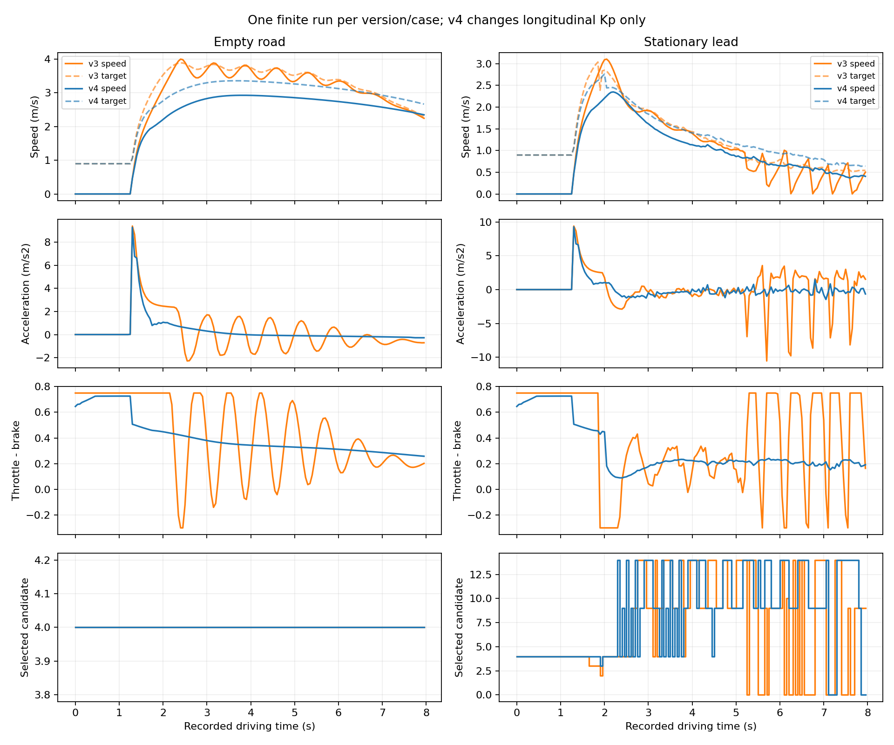

# v3 停走诊断与 v4 有限复测（2026-09-22）

## 结论

已完成已有 v3 数据的独立复算、固定本车状态的 PDM 反事实重放，以及只改纵向 PID 比例增益的一轮真实复测。证据支持：**v3 末段反复急刹到近零再大油门起步，主要由当前纵向控制配置放大；检测丢失或候选切换不是这一波动的主要解释。** 感知数值噪声、横向候选切换与低速转向状态仍有问题，没有被本次消除。

v4 空路和前车臂均通过原有有限时段验收，但**仍未证明稳定停车或驾驶底座全面通过**。前车末速 0.4061 m/s，最后两秒速度范围 0.3684–0.6875 m/s；起步最大加速度仍为 9.2746 m/s²。运行前新增的平顺性/持续低速诊断两项均失败，未修改门槛、延长运行或挑选较好时刻。

本批没有训练、LLM/MTR、P/F 获取、研究点二或 ToolV2X 方法收益实验。代码未提交/推送；原工作区修改及 v1/v2/v3 全部保留。

## v3 三层归因

1. **感知/跟踪：** 前车臂 160 个驾驶帧均为同一个 track 0，160/160 实际检测命中；没有 track 消失/重建引起的突然放行。这只排除本记录中的漏检/身份中断解释，不等于检测精度合格。位置、尺寸及速度仍有波动。
2. **PDM 候选：** 前车有 46 次候选切换；空路全部 160 帧选择 index 4，仍存在速度振荡及 9.3879 m/s² 起步峰值。因此候选切换不是所有波动的必要条件。前车末 60 帧的固定状态干预结果见下表。
3. **PID：** 使用保存的目标速度、本车三维速度和原 10 帧误差缓冲，独立重建原 PID 的油门/刹车；两臂最大误差均小于 3×10⁻⁸，符合 float32 控制存储误差。未发现 km/h 与 m/s 混用。Kp=1 时，忽略较小积分项，仅约 0.083 m/s 的超速误差便足以达到 0.3 的刹车上限；减速后正误差又使油门达到 0.75。

前车在记录 index 136、146、155、164 出现速度低于 0.01 m/s，随后再次超过 0.2 m/s。末 60 帧所有目标速度仍在 0.510–1.063 m/s，PDM 没有在这些停住时刻下达零速命令。它们不能解读为“PDM 已经停车，感知又突然放行”。

| 固定状态干预（前车末 60 帧） | 相对原目标速度平均绝对变化 | 最大绝对变化 |
|---|---:|---:|
| 仅把障碍速度置零 | 0.0097 m/s | 0.1294 m/s |
| 使用首个驾驶帧的同一检测 track 世界框并置零速度 | 0.0147 m/s | 0.0448 m/s |
| 强制执行 centerline / 最高限速比例候选 index 4 | 0.0197 m/s | 0.1795 m/s |
| 仅把本车输入转角置零 | 0.0106 m/s | 0.1819 m/s |

这些是**保持已记录本车状态的离线干预**；冻结框采用当时已有观测，不使用他车 GT。强制候选可能不符合原评分选择；零转角也不是真实转角替代。均不能解释为实施这些干预后的闭环结果。候选强制实验分别记录 scorer 的 selected_index 与实际 executed_index。

原始两臂共 320 次 PDM 重放，轨迹位置误差为 0、候选选择逐帧一致。另有上述 240 次干预，共 560 次离线 PDM 调用，没有重跑检测或读取未来观测。

## 另一个尚未修正的问题：全零候选分数

v3 前车有 14 帧所有候选分数为零，复算发现是所有候选的 **DRIVABLE_AREA** 乘性项为零，而非检测丢失或紧急制动。将本车输入转角置零后，这 14 帧不再全零；冻结障碍或障碍速度置零并不能消除。

当前转角由本车 yaw-rate / speed 的自行车模型近似计算，低于 0.2 m/s 时直接置零；上述帧输入转角约为 ±0.30–0.61 rad。这里既可能涉及实际横向跟踪，也涉及低速运动学近似的适用性，不能凭离线置零试验断言“真实转角应当为零”。原紧急制动只检查所选候选的碰撞时间，不能保证在越出车道导致全零评分时触发。v4 仍有 7 帧全零分数，此问题保留为下一项诊断。

## 唯一运行配置修正与预声明

`scripts/probe_pdm_closedloop.py` 的有效行为改动只有 longitudinal_pid.K_P 从 1.0 降至 0.2，版本升为 v4。CARLA 原 PID 算法未修改，但这属于**本地增益配置调整**，不能称“原参数不变”。Ki=0.05、Kd=0、横向增益及全部控制限幅保持原值。

PDM/vendor、检测/跟踪、轨迹差分速度规则、场景、路线、50 ms 步长、160 个驾驶步、原验收门槛均保持不变。与 v3 源码快照逐文件比较，所保存的其他 Python 文件内容相同；本轮运行源码另存 v4_sources。

运行前保存 `v4_predeclared.json`：一轮空路+前车；原验收之外，额外检查两臂全时段最大绝对加速度 <4 m/s²，以及前车最后 40 帧速度全部 <0.5 m/s。末 40 帧首末相隔 1.95 秒，本文简称末两秒；没有采样最后一次控制之后的状态。这两个诊断是本轮新增，不追溯改写旧批次验收定义。真实复测到此停止。

第一次启动遗漏项目已记录的进程 LD_LIBRARY_PATH，在检测器初始化时失败；0 帧采集、0 次检测前向、0 次 PDM。设置原有 spconv/环境库路径后重启，没有安装依赖或修改外部源码。失败目录保留为 `outputs/pdm_closedloop_2026_09_22_v4_setup_failed/`，不是一个被丢弃的驾驶样本。

## 真实 v3/v4 对照

| 指标 | v3 空路 | v4 空路 | v3 前车 | v4 前车 |
|---|---:|---:|---:|---:|
| 原验收 | PASS | PASS | FAIL | PASS |
| 位移 | 21.201 m | 17.394 m | 7.930 m | 7.377 m |
| 最终速度 | 2.243 m/s | 2.346 m/s | 0.5033 m/s | 0.4061 m/s |
| 最小纵向车身间距 | — | — | 2.168 m | 2.721 m |
| 碰撞 / 无效规划 | 0 / 0 | 0 / 0 | 0 / 0 | 0 / 0 |
| 全时段最大绝对加速度 | 9.388 | 9.275 | 10.553 | 9.275 |
| 最小纵向加速度 | −2.284 | −0.276 | −10.553 | −1.459 |
| 刹车达到 0.3 上限的帧数 | 2 | 0 | 15 | 0 |
| 近零停住后再起步次数 | 0 | 0 | 4 | 0 |
| 候选切换次数 | 0 | 0 | 46 | 50 |
| 全零候选评分帧数 | 0 | 0 | 14 | 7 |

加速度单位均为 m/s²；停走统计定义为从 ≥0.01 降至 <0.01 m/s，随后记录内再次 >0.2 m/s。v4 的停走次数降至零，但候选切换并未减少，进一步支持纵向控制配置对原停走波动的作用。每格仅一次工程运行；不提供统计泛化结论。

更小增益也有代价：空路位移减少，目标速度跟踪 RMSE 从 0.411 增至 0.538 m/s；前车从 0.433 增至 0.454 m/s。因此不能把 v4 称为所有指标更优，或稳定 4 m/s 巡航通过。

v4 起步约 1.2 秒仍为几乎静止、油门约 0.65–0.73，随后出现 9.27 m/s² 峰值。当前速度设定来自未来 0.5–1.0 秒路径段，静止时就约为 0.897 m/s。起步传动/实际控制时序与速度前视适配需要进一步拆分；本批尚未证明这一峰值的唯一根因。

v4 实际完成 340 次检测、320 次 PDM，全部驾驶帧状态为 pdm_pid，未触发适配层 hold。平均每帧处理为 77.1 / 101.3 ms，不含 world tick 和记录写出；同步仿真等待推理，仍不是实时 20 Hz。与前批一致，评价间距是纵向车身长度近似，未进行完整多边形距离评价。

## 验证、保留产物与下一步

- 原始输出：`outputs/pdm_closedloop_2026_09_22_v4/`；v1/v2/v3 未改写。
- 精简证据：`docs/evidence/pdm_closedloop_diagnosis_2026_09_22/`，含脚本、预声明、源码、配置、失败日志、PDM 重放、逐帧 CSV、对照图和指标 JSON。
- 从原始 rows 复算了全部 640 个 v3/v4 驾驶帧、两个版本的原验收与末帧指标，核对了连续 frame、50 ms 时间差、PDM timestamp 与点云文件数量。碰撞数引用保存的碰撞传感器事件，没有独立重建碰撞传感器。
- 16 项 PDM/控制定向测试通过，含独立原始上游模块对照；完整轻量回归 369 项通过（240.562 秒），定向测试耗时 3.518 秒，git diff --check 通过。测试 PASS 不覆盖这里未通过的真实驾驶诊断。
- 本次 CARLA 服务及 worker 已停止，GPU 回到 4 MiB / 0%；未修改任何外部模型/训练环境。

下一项应继续限定在底座：先检查已保存 v4 的短时速度设定、起步控制/挡位时序及低速转角来源，明确全零评分行为；针对性修正后再预声明有限持续停车验收。当前不因原末帧门槛 PASS 就接入更大训练或宣称 P/F 协作收益。P/F 与研究点一的真实收益仍需后续独立等预算对照。
