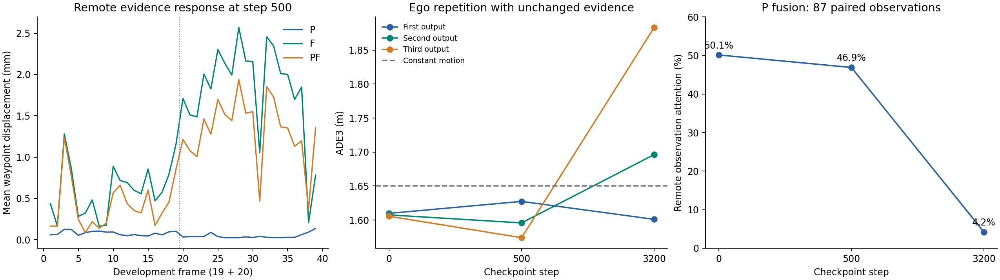

# 一次协作驾驶诊断：远端响应过弱，不能直接把恒速基底当修复

日期：2026-09-16。已实际执行冻结权重前向，不是只读旧均值。**主检查点上 P/F/PF 对轨迹的作用只有毫米量级；远端和本地内容并非完全重复。重复修订会退化，但直接替换数值基底没有修好它。下一步应处理驾驶器的证据使用与修订训练，暂不训练 LLM 调用策略。**

这份报告完成的是当前驾驶器定位，不宣称共同驾驶器已经合格。用户批准的后续架构为 LLM 组织请求、同一数值驾驶器直接使用 P/F、小请求网络作为对照；该 LLM 调度尚未实现。

## 1. 实际执行与可复查范围

- 复用扩样训练的全部39个完整开发帧，两个录制组分别19/20帧，156个真实Ego/P/F/PF任务。保持g5557因采集失败整帧排除，不重新挑选样本。
- 固定三个检查点：原选模step500为主；step0、step3200作为预先声明的诊断。没有重新选模。
- 正式collator、真实数值模型、原评价函数实际执行2460次完整模型前向，主运行192.02秒。另有117个恒速参考和468个基底代数分解，去除3次确定性复核后，共保存3042组完整六点输出。
- 后续解释性检查运行原观测编码/来源注意力模块，比较真实已关联证据；没有新增完整驾驶前向。
- 新优化步骤、provider查询、MTR运行、LLM调用均为0。三个模型参数前后逐张量相等，原检查点文件未改；GPU已释放。
- 完整DriverSpec/ExecutionSpec、模型身份、原采集成本和定位路径见运行记录。原归档请求由此前初始化模型形成，本批只重放其已购证据，不声称当前权重重新请求了邻车。PF也不是全量信息或性能上界。

规格：[预声明计划](single_cooperation_diagnostic_plan_2026_09_16.md)。完整产物：`outputs/single_cooperation_diagnostic_2026_09_16_v1/`。可携带复查包：[证据目录](evidence/single_cooperation_diagnostic_2026_09_16/README.md)。

## 2. 固定同一初始轨迹后，协作是否改变输出

同帧、同权重先产生一条Ego轨迹，再将它作为四个条件共同且不含远端信息的prior。每个条件都只再生成一次，因此下面比较不会把多一次生成当成通信收益。

主检查点step500：

| 输入条件 | ADE3（米） | 原前缀L2平均（米） | 相对同次数Ego的平均轨迹位移 | 任意帧任意点最大位移 |
|---|---:|---:|---:|---:|
| Ego同证据修订 | 1.595836 | 1.042237 | — | — |
| P后修订 | 1.595835 | 1.042235 | 0.061毫米 | 0.286毫米 |
| F后修订 | 1.596367 | 1.042549 | 1.223毫米 | 5.742毫米 |
| PF后修订 | 1.596200 | 1.042451 | 0.884毫米 | 4.332毫米 |

P、F、PF分别39/39帧的ADE变化都在预声明的±0.01米以内。该阈值是数值变化分类，不是显著性阈值。这里已检查逐帧六点轨迹，所以结论比“总体均值接近”更具体：**主模型对这些真实远端输入的直接轨迹响应很弱。**

step3200相应平均轨迹位移为P 0.312毫米、F 4.115毫米、PF 3.328毫米，三个条件仍各39/39帧ADE变化小于1厘米。不能因为训练更久后反应稍大，就称为协作学好了。

从P/F/PF批次移除直接远端观测与预测，并重建实体mask后，与相同prior的Ego输出仅有浮点级差异（平均位移最大约5.4e-8米）。这支持配对差别来自远端字段，而非本车特征、先前远端prior或实体数量残留导致的伪差异。

## 3. 远端是否只是重复本地信息

在真实来源和已有在线关联下补充比较内容，没有使用未来标签决定关联或选目标：

- P有120个入模远端观测实体，其中118个至少有两个有效历史状态，可构成causal tracking-state motion proxy；另外2个只有一个有效历史点。87组双源共有历史的平均XY差异为0.748米，中位数0.604米。
- F有156组远端预测。100组同帧同实体的本地/远端预测对，最高分模式轨迹平均相距2.515米，中位数1.492米。
- PF包含120个远端观测实体、123组远端预测。来源、模式与上下文没有在本批合并为一个虚构预测。

**因此，不能用“收到的东西完全相同”解释毫米级输出变化。** 但差异不等于正确增量：本批没有对每个目标重新配对独立未来GT，尚不能断言远端比本地准确；已有在线关联也不能被当作GT实体身份。

## 4. 可以定位到哪里，不能定位到哪里

### 4.1 并非所有环境输入都没有影响

在同一Ego prior下移除全部本地forecast，step500的输出平均移动0.066米，ADE增加0.022米；step3200移动0.567米，ADE增加0.235米。step3200屏蔽当前scene patches也会使输出平均移动0.135米。

这说明模型具有环境输入响应，不能说它完全只做恒速。上述mask干预可能改变输入分布，且prior仍包含原Ego环境信息，因此只用于定位直接输入通路，不是正式训练的“无环境”模型或环境总效应对照。

### 4.2 P来源融合在后期明显偏向本地

对P中87组双源共有观测，调用原编码器和source_attention读出的远端平均注意力权重为：

| 检查点 | 远端平均权重 |
|---|---:|
| step0 | 50.14% |
| step500 | 46.90% |
| step3200 | 4.21% |

这定位了后期来源融合偏向，但不是完整根因证明：step500的远端权重仍接近一半，最终P轨迹作用已很弱，说明只修来源权重不足以保证有效规划。注意力权重也不能直接解释最终结果的因果贡献。

### 4.3 F-only存在较多近原点未决身份

39个F任务中36个包含距离本车原点不超过现有ego_position_threshold_m的unresolved实体。P和PF分别只有3个。

F通常只有当前anchor，P有历史，有利于现有因果本车身份消歧。**本批没有把这36个实体直接认成真实Ego，也没有放宽过滤阈值删除它们。** 它们说明F字段中存在需要单列的身份不确定性，并可能占用请求/入模容量；不能将这部分预测全部解释成有价值的周围障碍物信息。

按预声明的时间对齐距离代理，39帧中27帧存在role=obstacle的附近交互代理。该子集的P/F/PF作用仍很小，不能只用“全部场景都毫无交互”解释。不过该代理不是交通事件或碰撞GT，当前两个开发录制组仍不足以判断数据集整体价值上限。

## 5. 对先前“固定恒速基底修复”的反证

step3200的Ego ADE：首次1.601米，同证据第二次1.696米，第三次1.883米，重复修订退化确实存在。

但对第二次前向保持编码和残差不变，执行“输出减去旧prior，再加恒速基底”的代数干预后，ADE变为**1.838米**，比原第二次更差。step500同样由1.596变为1.612米。

所以，**不实施“只换输出基底就修好了”的修改。** 问题涉及模型已经学到的条件化残差与训练目标，不能只凭代码有累加式就定位为唯一原因。该反证也不代表重新设计并训练后的固定基底方案必然无效。

## 6. 本批决定与下一项工作

1. 保留现有数据、MTR、P/F服务、receipt/ledger、对齐与实体结构，停止按原配置追加驾驶器训练。
2. 当前驾驶器不用于生产LLM请求效用监督：毫米级、可能带噪声的差异会给调用策略提供缺乏区分度的目标。
3. 下一项具体修改对象应是**共享驾驶器的证据融合与轨迹交互链路，以及与之匹配的首次/修订监督**。必须同时对照强Ego，并保留真实P状态和F未来内容；不能只调整来源权重、增加几层网络或换回恒速基底后继续长训。
4. 在锁定该改动之前，先给出复用实现到现有实体/预测输入的明确映射，并核验相关目标的本地/远端预测质量。该目标质量检查属于已有驾驶链路的数据核验，不需要先训练新预测骨干或搬迁数据集。
5. LLM负责调用的后续主方案继续保留，但本批不接入或训练LLM。没有在诊断后自动重建缓存或改动边界协议。

## 7. 实现与验证

- 新增 `src/evaluation/structured_evidence.py`：固定共用prior、直接证据干预、逐帧模型输出和成本/冻结审计。
- 新增 `scripts/verify_structured_evidence.py`：只用标准库从保存的六点坐标独立复算指标、合法性、主要配对与全部分组摘要。
- 新增5项诊断测试；与原驾驶器、规划评价、协议及vehicle tools共62项定向测试通过。未声称重跑全部仓库测试。
- 117个帧-检查点记录、3042组输出独立复算通过；故意改坏一个坐标时复算器拒绝。
- 三个检查点首次Ego的前缀L2与原归档差异最大约2.21e-9米。
- 原生产驾驶器、输入编码器、训练器源码与运行快照逐字节相等。本批没有修改它们或旧v1协议/黄金文件，没有训练，也没有提交/推送。

观察到的学习偏向与性能差异是开发集诊断证据，不是论文主实验、独立测试集结果、闭环安全验证或模型修复完成。
